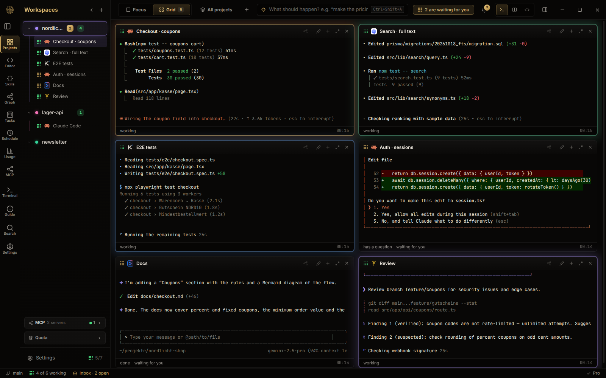
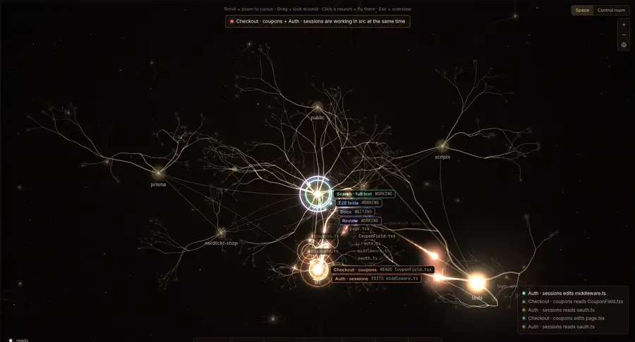
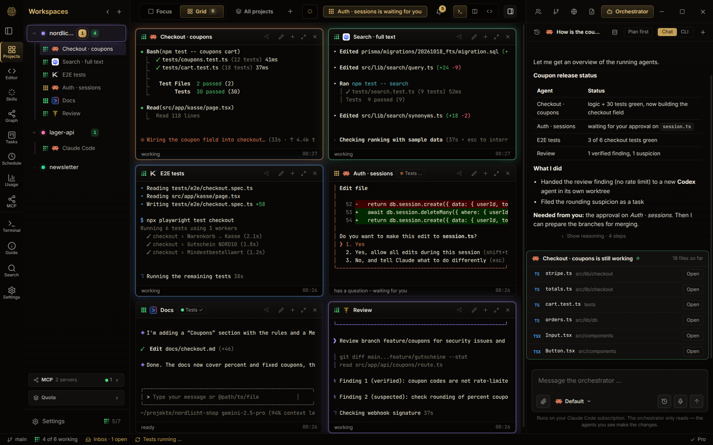
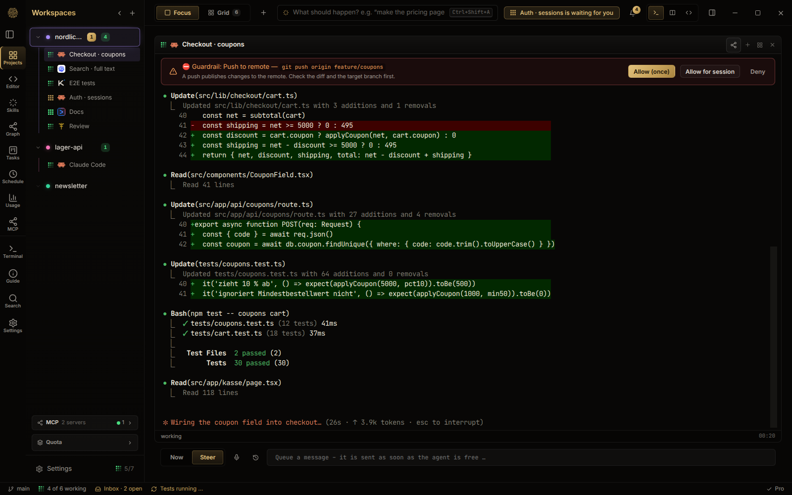
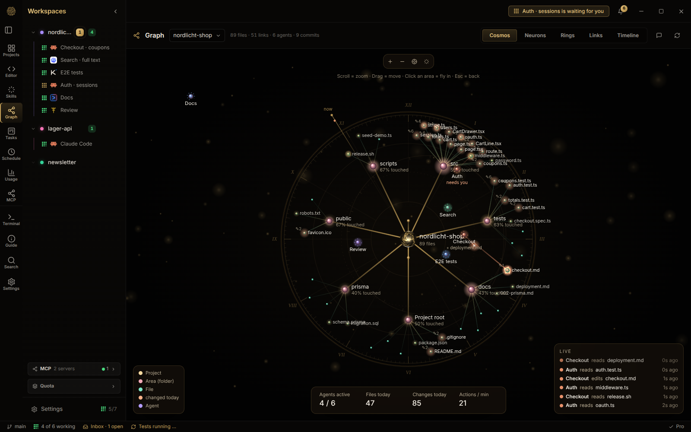
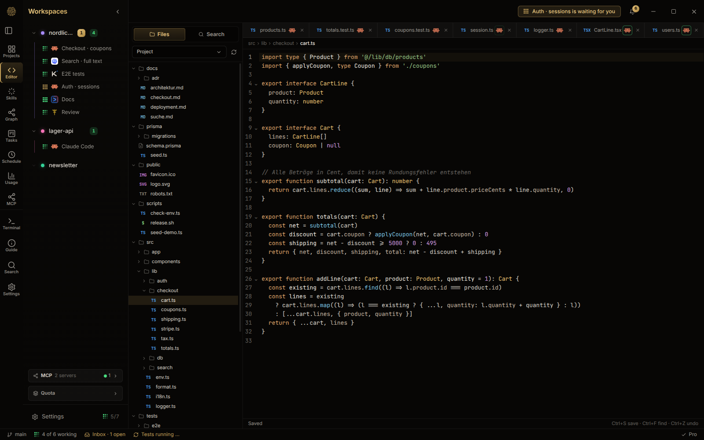

# OpenCognit

**Alle Coding-Agenten in einem Fenster.** OpenCognit ist eine Desktop-App für Linux und Windows. Sie führt Claude Code, Codex, Gemini CLI, Kimi und Hermes nebeneinander in echten Terminal-Sessions aus, lässt einen Agenten die anderen steuern und prüft deren Arbeit, bevor sie in deinem Projekt landet.

Lokal. Ohne Telemetrie. Ohne Konto bei uns. Einmal kaufen.

[Herunterladen](https://github.com/OpenCognitOS/opencognit-releases/releases/latest) · [Website](https://opencognitos.github.io) · [English](README.md)

> **In diesem Repository lag früher die quelloffene Agenten-Plattform OpenCognit.** Dieses Projekt ist eingestellt. Der Code bleibt unter der MIT-Lizenz im Branch [`legacy`](../../tree/legacy) verfügbar. OpenCognit geht als die hier beschriebene Desktop-App weiter. Sie ist ein kommerzielles Produkt und nicht quelloffen. Dieses Repository ist jetzt ihre öffentliche Adresse: Releases, Fehlermeldungen und Austausch.

## Was die App kann

- **Viele Agenten an einem Ort.** Echte Terminal-Sessions je CLI, in Fokus- oder Rasteransicht. Mehrere Logins je CLI (Arbeit und privat) bleiben getrennt.
- **Ein Orchestrator, der Arbeit verteilt.** Ein Agent startet andere, gibt jedem einen nummerierten Auftrag mit eigenem Dateibereich und erfährt, wenn sie berichten. Agenten können nicht außerhalb ihres Bereichs schreiben, und zwei offene Aufträge dürfen sich nicht überschneiden.
- **Guardrails, bevor etwas läuft.** Jeder Shell-Befehl eines Agenten wird gegen deine Regeln geprüft: sperren, nachfragen oder warnen. Vor Commits wird nach Schlüsseln gesucht.
- **Sehen, was passiert.** Ein Live-Graph zeigt, welcher Agent welche Datei liest oder ändert, und warnt, wenn zwei an derselben Stelle arbeiten.
- **Arbeit, die bleibt.** Sessions überleben den Neustart, Checkpoints führen zurück, geplante Aufträge und Nachtaufträge laufen im eigenen Arbeitsbaum und hinterlassen einen Bericht.
- **Dein Verbrauch, zusammengezählt.** Tokens aller CLIs aus ihren lokalen Protokollen, je Tag, Modell und Projekt.

## Ein Blick hinein

Neuronen: Jeder Agent ist ein Ring an dem Ordner, in dem er arbeitet. Impulse laufen in seiner Farbe über die Äste, wenn er eine Datei liest oder ändert.

Der Orchestrator verteilt Aufträge und meldet, was fertig ist, was scheiterte und was du entscheiden musst.

Guardrails: Ein Push zum Server wartet auf deine Freigabe.

Kosmos: das Projekt als Karte, mit jeder Datei, die ein Agent heute angefasst hat.

Editor: Dateien des Projekts lesen und ändern, ohne die App zu verlassen.

## Datenschutz

OpenCognit läuft auf deinem Rechner und nutzt die Abos, die du bei den Anbietern der CLIs schon hast. Es gibt keinen Server von uns dazwischen und keine Telemetrie. Das Ereignisprotokoll bleibt in einer lokalen Datenbank; vollständige Terminal-Ausgaben werden dort nie gespeichert. Die App selbst geht nur für eine kurze, dokumentierte Liste ins Netz: die Update-Prüfung, eine Abfrage des Paketnamens bei npm/PyPI, bevor ein Agent etwas installiert, und Funktionen, die du selbst einschaltest. Die [vollständige Liste](https://opencognitos.github.io/docs/de/security) nennt wann, wohin und was, damit du es mit einer Firewall wie OpenSnitch oder Portmaster nachprüfen kannst.

## Preis

- **Kostenlos:** bis zu 4 Sessions gleichzeitig.
- **Vollversion:** 69 € einmalig, inklusive 12 Monaten Updates. Die Lizenz wird offline geprüft.

## Installieren

Lade den Installer für dein System aus dem [neuesten Release](https://github.com/OpenCognitOS/opencognit-releases/releases/latest):

| System | Datei |
|---|---|
| Linux | `OpenCognit-linux-x86_64.AppImage` oder `OpenCognit-linux-amd64.deb` |
| Windows | `OpenCognit-windows-setup.exe` |

Du brauchst mindestens eine der unterstützten CLIs, installiert und angemeldet. Der Einrichtungs-Assistent findet sie beim ersten Start.

## Fragen und Probleme

- **Etwas kaputt?** [Fehler melden](../../issues/new/choose).
- **Idee oder Frage?** Dafür gibt es die [Discussions](../../discussions) und den [Discord](https://discord.gg/xASbhwdaS).

## Lizenz

OpenCognit Desktop ist proprietäre Software, © OpenCognit. Das frühere quelloffene Projekt im Branch `legacy` bleibt unter der MIT-Lizenz.
