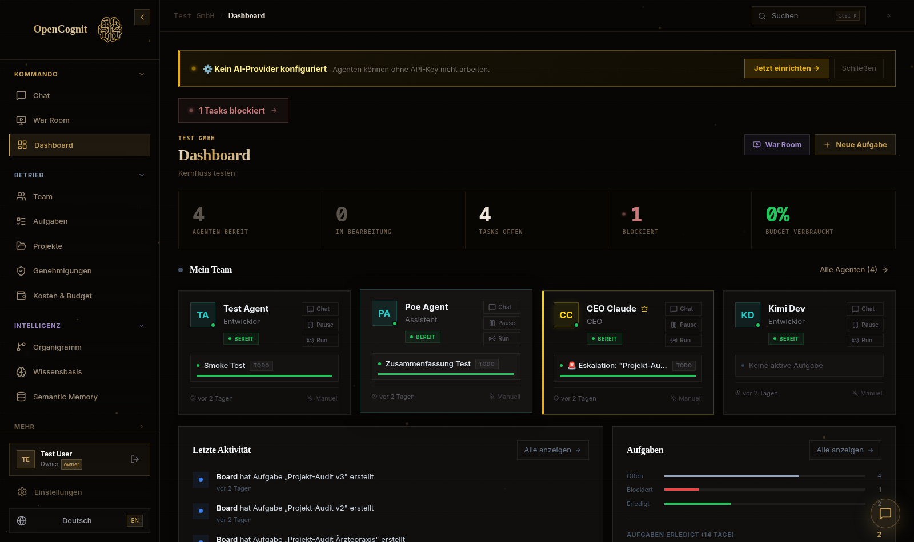
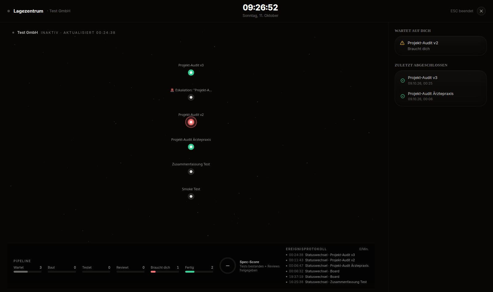
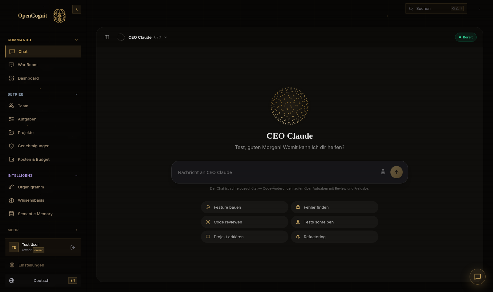

<div align="center">


# OpenCognit

**Build Your Zero Human Company.**

The AI agent orchestration OS — CEO orchestrator, persistent memory, real execution, atomic budgets. Self-hosted. No cloud lock-in.

[](LICENSE)
[](https://nodejs.org)
[](https://www.typescriptlang.org)
[](https://github.com/OpenCognit/opencognit/stargazers)
 

[](https://star-history.com/#OpenCognit/opencognit&Date)

</div>

---

## What is OpenCognit?

OpenCognit is an **AI agent orchestration OS** — not a chatbot, not a single-agent wrapper. It runs a **virtual company** of autonomous AI agents that work together without you watching.

You set a goal. The CEO agent breaks it down, assigns tasks to specialists, reviews their work with a built-in Critic loop, and escalates blockers — while you sleep.

```
You → Goal → CEO Agent → Dev Agent → Writer Agent → Researcher Agent
                 ↑               ↓              ↓
          Persistent Memory ←── Critic ←── Results ←────┘
```

---

## Screenshots

<p align="center">
  
</p>
<p align="center">
  
</p>
<p align="center">
  
</p>

---

## Core Features

- **CEO Orchestrator** — Extended Thinking before delegation
- **Persistent Memory** — MemPalace + Semantic + SOUL documents per agent
- **Critic Loop** — Every output reviewed before "done"
- **Atomic Budgets** — Hard limits enforced at the cent level
- **Task DAG** — Dependencies auto-resolve, downstream tasks unlock
- **War Room** — Live swarm view of agents executing your task graph
- **CEO Chat** — Talk directly to your CEO agent (streaming, CLI-backed)
- **Org Chart** — Agent hierarchies, roles, and peer meetings
- **Plugin System** — Custom adapters, widgets, API endpoints
- **MCP Server** — Use OpenCognit from Cursor, Claude Code, Windsurf
- **CLI Executor** — Live bash streaming with SSE

---

## Quick Start

```bash
# 1. Clone
git clone https://github.com/OpenCognit/opencognit.git
cd opencognit

# 2. Setup
bash setup.sh

# 3. Run
npm run dev
```

The UI opens at `http://localhost:3200`. The API runs on `http://localhost:3201`.

---

## Architecture

```
┌─────────────────────────────────────────┐
│           React 19 + Vite 6             │
│     Glassmorphism UI, Dark Mode         │
└─────────────┬───────────────────────────┘
              │ REST / SSE / WebSocket
┌─────────────▼───────────────────────────┐
│      Express 5 + SQLite/PostgreSQL      │
│  ┌─────────┐ ┌─────────┐ ┌──────────┐  │
│  │  CEO    │ │ Critic  │ │  Memory  │  │
│  │Orchestr.│ │  Loop   │ │  Palace  │  │
│  └─────────┘ └─────────┘ └──────────┘  │
│  ┌─────────┐ ┌─────────┐ ┌──────────┐  │
│  │  Task   │ │ Budget  │ │  Agent   │  │
│  │   DAG   │ │ Control │ │ Registry │  │
│  └─────────┘ └─────────┘ └──────────┘  │
└─────────────────────────────────────────┘
              │ Adapters (Anthropic, OpenAI, Ollama, ...)
┌─────────────▼───────────────────────────┐
│     LLM Providers + Local Models        │
└─────────────────────────────────────────┘
```

---

## Tech Stack

| Layer | Technology |
|-------|-----------|
| Frontend | React 19, Vite 6, Tailwind CSS, Framer Motion |
| Backend | Express 5, TypeScript strict, ESM |
| Database | SQLite (WAL) / PostgreSQL |
| ORM | Drizzle ORM |
| Auth | BetterAuth + JWT fallback |
| Real-time | WebSocket + Server-Sent Events |
| Validation | Zod |
| Testing | Vitest + Playwright |

---

## Community

- 🐦 [X / Twitter](https://x.com/opencognit)

---

## License

OpenCognit is open source under the [MIT License](LICENSE).

Copyright © 2026 Panto.
