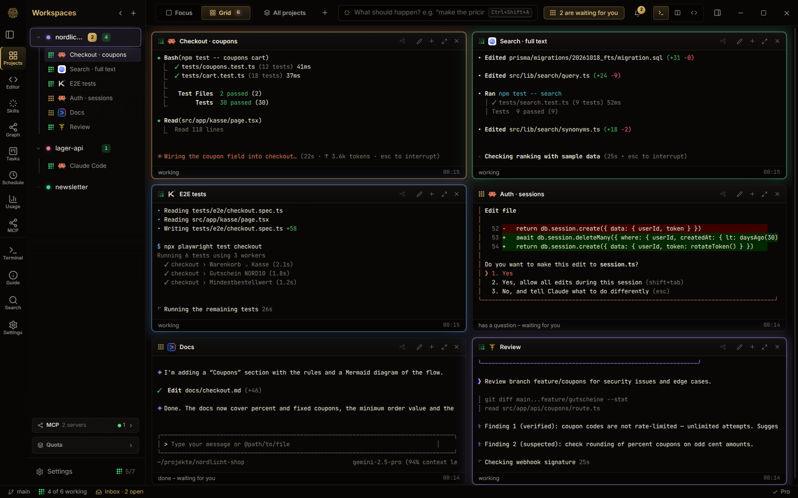
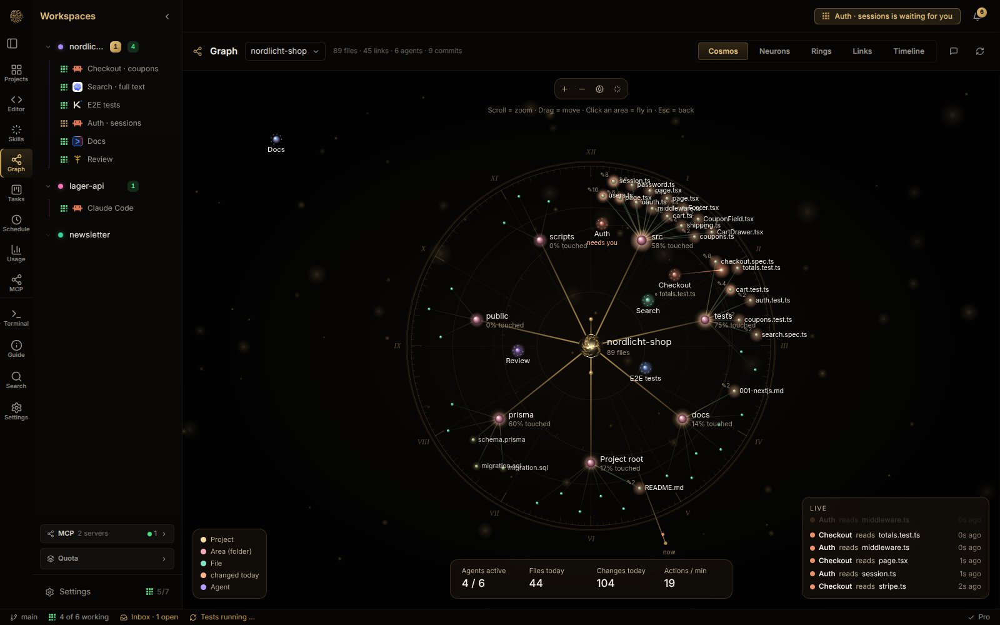

# OpenCognit

**Every coding agent in one window.** OpenCognit is a desktop app for Linux and Windows that runs Claude Code, Codex, Gemini CLI, Kimi and Hermes side by side in real terminal sessions, lets one of them orchestrate the others, and checks their work before it reaches your project.

Local. No telemetry. No account with us. One-time purchase.

[Download](https://github.com/OpenCognitOS/opencognit-releases/releases/latest) · [Website](https://opencognitos.github.io) · [Deutsch](README.de.md)

> **This repository used to host the open-source OpenCognit agent platform.** That project is discontinued. Its code stays available under the MIT license in the [`legacy`](../../tree/legacy) branch. OpenCognit continues as the desktop app described here, which is a commercial product and not open source. This repository is now its public home: releases, issues, and discussion.

## What it does

- **Many agents, one place.** Real PTY sessions for each CLI, in a focus view or a grid. Several logins per CLI (work and private) stay separate.
- **An orchestrator that hands out work.** One agent starts others, gives each a numbered task and its own set of files, and is told when they report back. Agents cannot write outside their files, and two open tasks cannot overlap.
- **Guardrails before anything runs.** Every shell command an agent wants to run is checked against your rules: block, ask you, or warn. Commits are scanned for secrets first.
- **See what is happening.** A live graph shows which agent reads or changes which file and warns when two work in the same place.
- **Work that survives.** Sessions resume after a restart, checkpoints let you jump back, scheduled and overnight tasks run in their own worktree and leave a report.
- **Your usage, added up.** Tokens of all CLIs from their local logs, per day, model and project.

## Privacy

OpenCognit runs on your machine and uses the subscriptions you already have with each CLI vendor. It has no server of ours in the loop and sends no telemetry. The event log stays in a local database; full terminal output is never stored in it. The update check reads one version file and nothing else.

## Price

- **Free:** up to 4 sessions at the same time.
- **Full version:** 69 € once, including 12 months of updates. The licence is checked offline.

## Install

Download the installer for your system from the [latest release](https://github.com/OpenCognitOS/opencognit-releases/releases/latest):

| System | File |
|---|---|
| Linux | `OpenCognit-linux-x86_64.AppImage` or `OpenCognit-linux-amd64.deb` |
| Windows | `OpenCognit-windows-setup.exe` |

You need at least one of the supported CLIs installed and logged in. The setup assistant finds them on first start.

## Questions and problems

- **Something broken?** [Open an issue](../../issues/new/choose).
- **An idea or a question?** Use [Discussions](../../discussions).

## Licence

OpenCognit Desktop is proprietary software, © OpenCognit. The former open-source project in the `legacy` branch remains under the MIT license.
